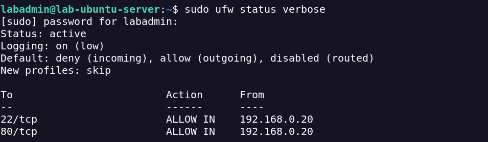
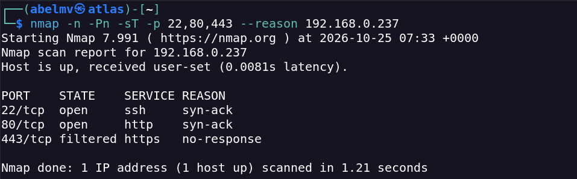
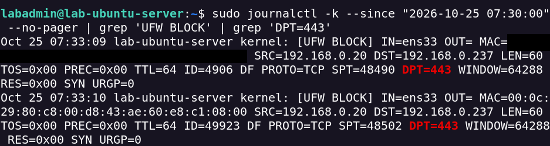
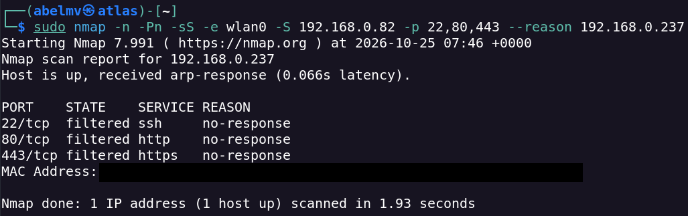
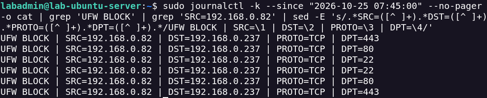
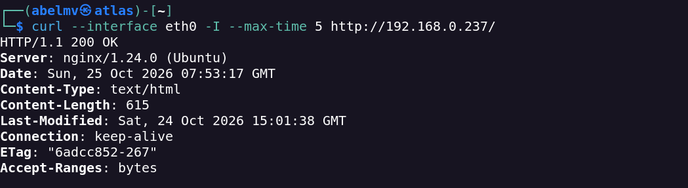

# Network Firewall & Traffic Filtering

## Overview

This self-hosted lab examines source-based access controls configured with UFW on Ubuntu Server. Nmap scans from two IPv4 addresses were compared with firewall logs to verify blocked traffic and confirm that authorised services remained accessible.

**Completed:** 25 October 2026  
**Environment:** Authorised local lab

## Objectives

- Verify UFW access controls for authorised and unauthorised IPv4 sources.
- Compare TCP port states observed through Nmap.
- Correlate scan results with `UFW BLOCK` events.
- Confirm that legitimate HTTP access remained available.

## Lab Environment

| Component | Configuration |
|---|---|
| Testing machine | Kali Linux |
| Target | Ubuntu Server 24.04.5 LTS |
| Virtualisation | VMware Workstation Pro (Bridged networking) |
| Authorised source | `192.168.0.20` — `eth0` |
| Unauthorised test source | `192.168.0.82` — `wlan0` |
| Target IP | `192.168.0.237` |
| Firewall | UFW |
| Services | OpenSSH (TCP/22), Nginx HTTP (TCP/80) |
| Additional test port | TCP/443 |
| Tools | UFW, Nmap, `journalctl`, `curl` |

The lab reused the infrastructure established in [Network Reconnaissance & Service Enumeration](../network-reconnaissance/README.md). Both test source addresses belonged to interfaces on the same Kali Linux machine; the second source was not an independent attacker host.

## Methodology and Findings

### 1. UFW Baseline Verification

The existing firewall policy was inspected on Ubuntu Server:

```bash
sudo ufw status verbose
```

| Setting | Observed configuration |
|---|---|
| Firewall | Active |
| Logging | On (low) |
| Incoming policy | Deny |
| Outgoing policy | Allow |
| TCP/22 | Allow from `192.168.0.20` |
| TCP/80 | Allow from `192.168.0.20` |
| TCP/443 | No explicit allow rule |

**Finding:** SSH and HTTP were explicitly permitted from the authorised source only. No firewall rules were changed during this lab.

**Evidence — UFW baseline:**



### 2. Authorised Source Scan

Nmap was run from Kali Linux using the authorised Ethernet connection:

```bash
nmap -n -Pn -sT -p 22,80,443 --reason 192.168.0.237
```

| Port | State | Reason |
|---|---|---|
| 22/tcp | `open` | `syn-ack` |
| 80/tcp | `open` | `syn-ack` |
| 443/tcp | `filtered` | `no-response` |

**Finding:** SSH and HTTP were reachable from the authorised source. TCP/443 did not respond, consistent with the restrictive firewall policy; the firewall logs were checked to investigate this further.

**Evidence — authorised scan:**



### 3. TCP/443 Firewall Log Verification

The Ubuntu Server kernel logs were inspected for blocked traffic to TCP/443:

```bash
sudo journalctl -k --since "2026-10-25 07:30:00" --no-pager | grep 'UFW BLOCK' | grep 'DPT=443'
```

Two `UFW BLOCK` events were identified at **07:33:09** and **07:33:10**.

| Field | Observed value |
|---|---|
| Source | `192.168.0.20` |
| Destination | `192.168.0.237` |
| Destination port | TCP/443 |
| Target interface | `ens33` |
| TCP flag | SYN |
| Action | `UFW BLOCK` |

**Finding:** The logs provided evidence that UFW blocked TCP SYN packets from the authorised source to port 443 during the test. A `filtered` scan result alone would not identify the filtering device or rule.

**Evidence — TCP/443 block events:**



### 4. Unauthorised Source Scan

A separate Nmap SYN scan was run using Kali's Wi-Fi interface and its IPv4 address:

```bash
sudo nmap -n -Pn -sS -e wlan0 -S 192.168.0.82 -p 22,80,443 --reason 192.168.0.237
```

| Port | Authorised source | Unauthorised source |
|---|---|---|
| TCP/22 | `open` | `filtered` |
| TCP/80 | `open` | `filtered` |
| TCP/443 | `filtered` | `filtered` |

**Finding:** SSH and HTTP were accessible from the authorised IPv4 source but appeared filtered from the unauthorised test source. This matched the source restrictions observed in the UFW baseline.

**Evidence — unauthorised scan:**



### 5. Unauthorised Source — UFW Log Validation

The logs were filtered for blocked packets originating from the unauthorised IPv4 address:

```bash
sudo journalctl -k --since "2026-10-25 07:45:00" --no-pager | grep 'UFW BLOCK' | grep 'SRC=192.168.0.82'
```

The recorded events were also condensed using `grep` and `sed` to display the source, destination, protocol and destination port.

| Field | Observed result |
|---|---|
| Source | `192.168.0.82` |
| Destination | `192.168.0.237` |
| Protocol | TCP |
| Blocked destination ports | 22, 80, 443 |
| Events identified | 6 — two per port |
| Action | `UFW BLOCK` |

**Finding:** The firewall logs corroborated the Nmap observations by recording blocked packets from the unauthorised source to all three ports. The evidence below is a **processed summary**, not an unmodified full log export.

**Evidence — unauthorised source blocks:**



### 6. Authorised HTTP Access Verification

Finally, HTTP availability was checked from the authorised Ethernet interface:

```bash
curl --interface eth0 -I --max-time 5 http://192.168.0.237/
```

**Observed response:**

```http
HTTP/1.1 200 OK
Server: nginx/1.24.0 (Ubuntu)
Content-Type: text/html
Content-Length: 615
```

**Finding:** Nginx still responded successfully to an authorised HTTP HEAD request following the filtering tests. This confirmed that the tested firewall restrictions did not prevent legitimate HTTP access from that source.

**Evidence — authorised HTTP response:**



## Security Analysis

The results supported the effectiveness of the tested IPv4 source-based firewall restrictions:

- SSH and HTTP were reachable from `192.168.0.20` and filtered from `192.168.0.82`.
- TCP/443 remained filtered from both test addresses.
- `UFW BLOCK` events helped distinguish observed filtering from an unexplained lack of response.
- An authorised HTTP request continued to succeed after the tests.

**Recommendations:**

- Maintain a restrictive inbound firewall policy and allow only required sources and ports.
- Review firewall logs and verify controls using both permitted and denied connections.
- Keep authentication and encryption controls in place; IP-based filtering is not a substitute for either.
- Review IPv4 and IPv6 rules according to the system's exposure and requirements.

## Results and Limitations

The tests confirmed the expected access differences for TCP/22, TCP/80 and TCP/443, supported by Nmap results, UFW logs and a successful HTTP response. Six screenshots were retained as evidence.

The scope was limited to **three TCP ports and two IPv4 interfaces on one Kali Linux machine**. No IPv6 rules, evasion techniques or IP-spoofing protections were tested. The existing UFW rules were validated, not changed, and the results do not constitute a comprehensive security audit.

## Lessons Learned

This lab strengthened my understanding of source-based firewall controls, TCP Connect and SYN scans, interpreting `open` and `filtered` results, and correlating scan observations with system logs. It also reinforced the importance of verifying that authorised services remain available while testing blocked traffic.

## References

- [Ubuntu Server — Firewalls](https://documentation.ubuntu.com/server/how-to/security/firewalls/)
- [Nmap Reference Guide](https://nmap.org/book/man.html)
- [journalctl Manual](https://man7.org/linux/man-pages/man1/journalctl.1.html)
- [Nginx Documentation](https://nginx.org/en/docs/)
