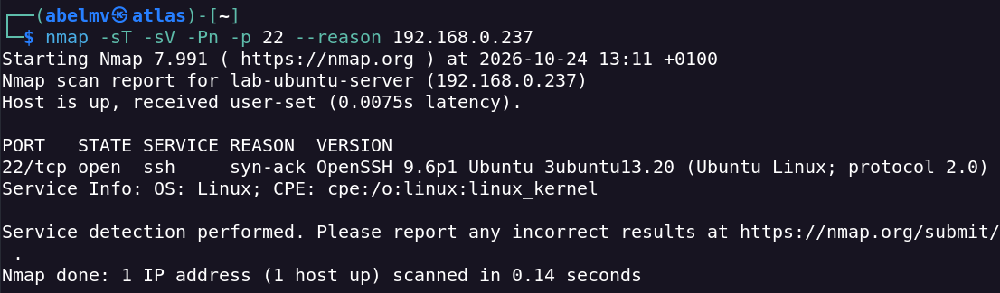
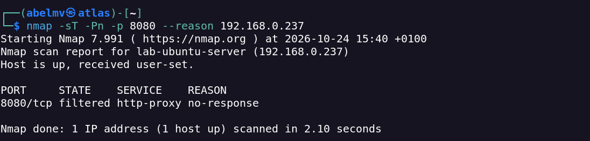
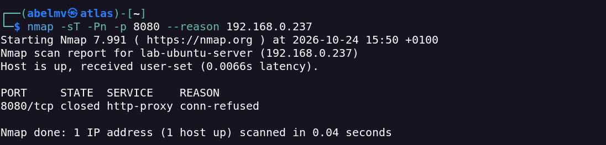
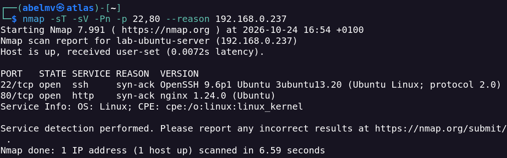
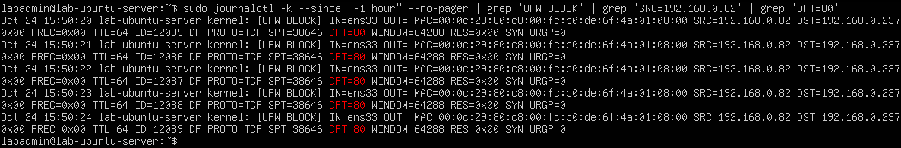

# Network Reconnaissance & Service Enumeration

## Overview

This self-hosted lab explores network reconnaissance, TCP port states, service enumeration and firewall access controls using Kali Linux and Ubuntu Server.

The investigation focused on SSH and HTTP services, examining how UFW firewall rules affect their accessibility from different source IP addresses.

**Completed:** 24 October 2026  
**Environment:** Authorised local lab

## Objectives

- Identify active network services and their versions.
- Analyse TCP port states using Nmap.
- Examine the effects of firewall rules on service accessibility.
- Validate source-based access restrictions through connection tests and firewall logs.

## Lab Environment

| Component | Configuration |
|---|---|
| Attacker | Kali Linux |
| Target | Ubuntu Server 24.04.5 LTS |
| Virtualisation | VMware Workstation Pro |
| Network | Bridged (VMnet0) |
| Firewall | UFW |
| Services | OpenSSH, Nginx |
| Tools | Nmap, Netcat, UFW, Nginx |

The Ubuntu Server virtual machine was connected to the local network through VMware Bridged networking.

The tests used the following private IPv4 addresses:

- **Authorised source:** `192.168.0.20`
- **Unauthorised source:** `192.168.0.82`
- **Target server:** `192.168.0.237`

## Methodology and Findings

### 1. Connectivity Verification

Initial ICMP testing from Kali Linux produced no responses:

```bash
ping -I eth0 -c 4 192.168.0.237
```

However, a TCP connectivity test confirmed that SSH was accessible:

```bash
nc -vz -w 5 -s 192.168.0.20 192.168.0.237 22
```

**Finding:** The lack of ICMP responses did not indicate a complete loss of network connectivity. The exact reason for the ICMP behaviour was not established.

### 2. SSH Service Enumeration

Nmap was used to identify the SSH service and its version:

```bash
nmap -sT -sV -Pn -p 22 --reason 192.168.0.237
```

**Result:**

```text
22/tcp open ssh
OpenSSH 9.6p1 Ubuntu 3ubuntu13.20
```

The detected version was checked against the installed OpenSSH package on Ubuntu Server.

**Evidence — SSH service and version detection:**



### 3. TCP Port States: Filtered vs Closed

TCP port 8080 was examined before and after temporarily allowing connections through UFW.

**Initial scan:**

```bash
nmap -sT -Pn -p 8080 --reason 192.168.0.237
```

**Result:**

```text
8080/tcp filtered http-proxy no-response
```

**Evidence — filtered port:**



A temporary firewall rule was introduced:

```bash
sudo ufw allow from 192.168.0.20 to any port 8080 proto tcp
```

The subsequent scan returned:

```text
8080/tcp closed http-proxy conn-refused
```

**Evidence — closed port:**



| Scenario | Port State | Observation |
|---|---|---|
| Traffic restricted by UFW | `filtered` | No response |
| Traffic permitted, no listening service | `closed` | Connection refused |

**Finding:** Allowing traffic through a firewall does not mean that a service is listening on the destination port.

The temporary UFW rule was removed after testing.

### 4. HTTP Service Enumeration

Nginx was installed and verified on Ubuntu Server.

An initial scan returned:

```text
80/tcp filtered http no-response
```

HTTP access was then permitted from the authorised source:

```bash
sudo ufw allow from 192.168.0.20 to any port 80 proto tcp
```

Nmap service detection was repeated:

```bash
nmap -sT -sV -Pn -p 80 --reason 192.168.0.237
```

**Result:**

```text
80/tcp open http
nginx 1.24.0 (Ubuntu)
```

**Finding:** A service can be running locally while remaining inaccessible from the network because of firewall restrictions.

### 5. Final Service Enumeration

A final scan was performed against the authorised SSH and HTTP services:

```bash
nmap -sT -sV -Pn -p 22,80 --reason 192.168.0.237
```

| Port | State | Service | Detected Version |
|---|---|---|---|
| 22/tcp | Open | SSH | OpenSSH 9.6p1 |
| 80/tcp | Open | HTTP | Nginx 1.24.0 |

Both services were accessible from the authorised source IP address.

**Evidence — final SSH and HTTP enumeration:**



### 6. Firewall Access Control Validation

UFW rules were tested using connections originating from two different network interfaces.

| Service | Authorised Source | Unauthorised Source |
|---|---|---|
| SSH — TCP/22 | Accessible | Blocked |
| HTTP — TCP/80 | Accessible | Blocked |

Firewall logs were inspected using `journalctl`.

Entries containing `UFW BLOCK` confirmed that TCP SYN packets originating from the unauthorised source were blocked for both services.

**Evidence — UFW blocking HTTP traffic from the unauthorised source:**



The validation was limited to the source addresses and services tested. The screenshot above documents HTTP blocking; the SSH blocking result was also verified in firewall logs during the lab.

## Security Analysis

The investigation demonstrated several important network security principles:

- Service availability depends on both the application and the network filtering configuration.
- A `filtered` port does not establish whether a service is listening.
- A `closed` port indicates that the connection was rejected rather than accepted by a listening service.
- Source-based firewall rules can restrict access to specific network services.
- Firewall logs provide supporting evidence when validating access restrictions.

### Recommendations

- Apply restrictive default firewall policies.
- Allow only required services and authorised sources.
- Review listening ports and service configurations regularly.
- Keep network-facing services updated.
- Monitor firewall logs and validate filtering rules through testing.

## Results

The lab successfully demonstrated:

- TCP connectivity verification.
- SSH and HTTP service enumeration.
- Service version identification.
- Differences between `open`, `closed` and `filtered` TCP ports.
- UFW access control validation using different source IPv4 addresses.
- Correlation between network test results and firewall logs.

## Limitations

- Testing focused on TCP ports 22, 80 and 8080.
- No comprehensive vulnerability assessment was performed.
- The firewall tests were limited to two IPv4 source addresses.
- Equivalent IPv6 access control testing was not conducted.
- The reason for the lack of ICMP responses was not established.

## Lessons Learned

This project strengthened my understanding of TCP connectivity, Nmap service enumeration, firewall behaviour and the importance of validating network security controls through practical tests.

It also highlighted the value of comparing remote scan results with local service information and firewall logs.

## References

- [Nmap Reference Guide](https://nmap.org/book/man.html)
- [Ubuntu Server Documentation](https://documentation.ubuntu.com/server/)
- [UFW Manual](https://manpages.ubuntu.com/manpages/noble/en/man8/ufw.8.html)
- [Nginx Documentation](https://nginx.org/en/docs/)
