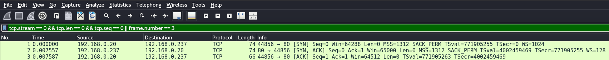
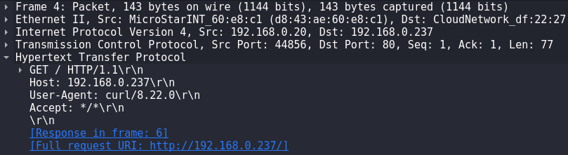
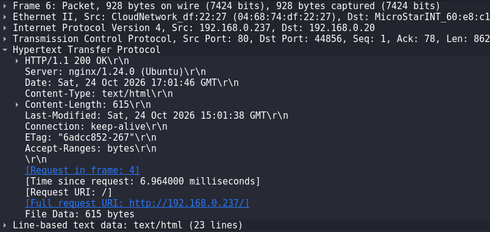
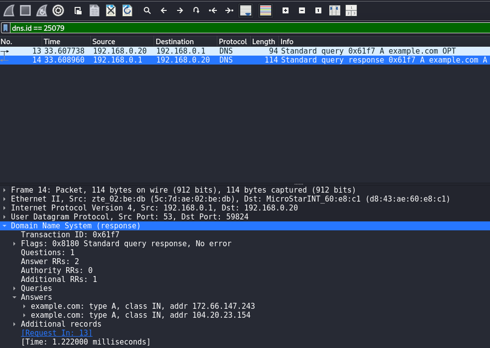

# Network Traffic Analysis — TCP, HTTP & DNS

## Overview

This self-hosted lab examines TCP connection establishment, HTTP communication and DNS resolution using packet captures from a controlled network environment.

Traffic was captured with `tcpdump` and analysed using Wireshark and TShark to identify protocol behaviour, request–response relationships and security-relevant details.

**Completed:** 24 October 2026  
**Environment:** Authorised local lab

## Objectives

- Capture and interpret a TCP three-way handshake.
- Identify HTTP requests, responses and relevant headers.
- Examine a DNS query and correlate it with its response.
- Consider the security implications of traffic visible in packet captures.

## Lab Environment

| Component | Configuration |
|---|---|
| Analysis machine | Kali Linux |
| Target | Ubuntu Server 24.04.5 LTS |
| Virtualisation | VMware Workstation Pro |
| Network | Bridged |
| Kali interface and IP | `eth0` — `192.168.0.20` |
| Target IP | `192.168.0.237` |
| HTTP service | Nginx — TCP/80 |
| DNS server | `192.168.0.1` |
| Test domain | `example.com` |
| Tools | tcpdump, Wireshark, TShark, curl, dig |

The lab reused the environment from [Network Reconnaissance & Service Enumeration](../network-reconnaissance/README.md).

## Methodology and Findings

### 1. TCP Three-Way Handshake

Traffic between Kali Linux and the Nginx server was captured with:

```bash
sudo tcpdump -i eth0 -nn -s 0 -c 20 -w /tmp/lab02-tcp-handshake.pcap 'host 192.168.0.237 and tcp port 80'
```

An HTTP request was generated from another terminal:

```bash
curl --interface eth0 http://192.168.0.237/
```

The capture was inspected in Wireshark and TShark.

| Frame | Direction | TCP flags |
|---|---|---|
| 1 | Kali `44856` → Ubuntu `80` | SYN |
| 2 | Ubuntu `80` → Kali `44856` | SYN, ACK |
| 3 | Kali `44856` → Ubuntu `80` | ACK |

The handshake completed in approximately **7.587 ms**, based on the packet timestamps.

**Finding:** The SYN, SYN-ACK and ACK sequence confirmed TCP connection establishment, but did not by itself establish whether the HTTP application would respond successfully.

**Evidence — TCP three-way handshake:**



### 2. HTTP Traffic Analysis

The same capture was used to inspect the HTTP exchange. The following Wireshark display filter was applied:

```text
http
```

**Request — frame 4:**

```http
GET / HTTP/1.1
Host: 192.168.0.237
User-Agent: curl/8.22.0
Accept: */*
```

The client requested the Nginx server's home page.

**Evidence — HTTP GET request:**



**Response — frame 6:**

```http
HTTP/1.1 200 OK
Server: nginx/1.24.0 (Ubuntu)
Content-Type: text/html
Content-Length: 615
```

The response contained HTML, with a measured request-to-response interval of approximately **6.964 ms**.

**Finding:** The packet capture exposed the HTTP request and response headers, including the server version. This lab used unencrypted HTTP; no credentials or personal information were intentionally transmitted.

**Evidence — HTTP 200 OK response:**



### 3. DNS Traffic Analysis

A DNS capture was taken for communication between Kali Linux and the configured DNS server:

```bash
sudo tcpdump -i eth0 -nn -s 0 -w /tmp/lab02-dns-final.pcap 'host 192.168.0.1 and host 192.168.0.20 and udp port 53'
```

An IPv4 address query was generated using:

```bash
dig @192.168.0.1 example.com A +tries=1 +time=3 +noall +question +answer +comments
```

The DNS transaction was isolated in Wireshark with the display filter:

```text
dns.id == 25079
```

| Field | Observed result |
|---|---|
| Client | `192.168.0.20` |
| DNS server | `192.168.0.1` |
| Query | `example.com`, type A |
| Transport | UDP/53 |
| Transaction ID | `0x61f7` (25079) |
| Response code | `NOERROR` |
| Answer records | 2 |
| Response time | Approximately 1.222 ms |

The query appeared in **frame 13** and the response in **frame 14**. Two A records were observed: `172.66.147.243` and `104.20.23.154`.

**Finding:** The matching transaction ID linked the request to its response. The successful response demonstrated how unencrypted DNS exchanges can reveal requested domains and returned addresses to someone with access to the traffic.

**Troubleshooting:** An earlier DNS capture recorded outgoing queries but not the corresponding responses, although `dig` received them. After checking the interface, a new capture recorded both messages. The exact reason for the incomplete first capture was not determined.

**Evidence — DNS query and response:**



## Security Analysis

| Protocol | Security relevance |
|---|---|
| TCP | Connection establishment can help identify unexpected or unusual network behaviour. |
| HTTP | Unencrypted requests, responses and headers can be inspected by observers with traffic visibility. |
| DNS | Traditional unencrypted queries and responses can reveal domain-resolution activity. |

**Recommendations:**

- Prefer HTTPS to protect application data in transit.
- Investigate unexpected TCP connections and anomalous DNS activity.
- Validate capture interfaces and filters before drawing conclusions.
- Handle PCAP files carefully because they may contain sensitive network data.

## Results

The lab confirmed a TCP three-way handshake, an HTTP GET request and `200 OK` response, and a DNS A-record query correlated with its response. Four Wireshark screenshots were retained as technical evidence.

The original TCP/HTTP and DNS PCAP files are kept privately and are **not included in this repository**.

## Limitations

- Testing covered selected TCP, HTTP and DNS exchanges, not comprehensive traffic analysis.
- HTTP and HTTPS were not compared experimentally.
- Other DNS record types were not investigated.
- The cause of the initially incomplete DNS capture remains unknown.
- No full investigation of malicious network traffic was performed.

## Lessons Learned

The lab improved my ability to interpret TCP flags, inspect HTTP messages, correlate DNS requests and responses, and use packet captures to support technical findings. It also reinforced the importance of checking capture completeness before reaching conclusions.

## References

- [Wireshark User's Guide](https://www.wireshark.org/docs/wsug_html_chunked/)
- [tcpdump Manual](https://www.tcpdump.org/manpages/tcpdump.1.html)
- [DNS — RFC 1035](https://www.rfc-editor.org/rfc/rfc1035)
- [TCP — RFC 9293](https://www.rfc-editor.org/rfc/rfc9293)
- [HTTP Semantics — RFC 9110](https://www.rfc-editor.org/rfc/rfc9110)
